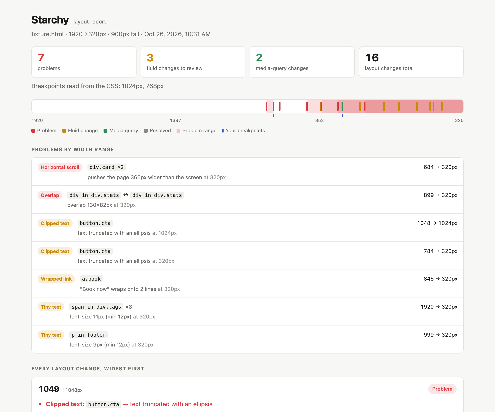

# starchy

[](https://www.npmjs.com/package/starchy)
[](LICENSE)
[](package.json)

**Keep your layout crisp at every width.**

starchy finds every screen width where your page's layout changes, and
flags the changes that are bugs.

```bash
npx starchy https://example.com
```



Website: [starchy.dev](https://starchy.dev)

## Why

Most responsive testing screenshots a handful of fixed breakpoints, such as 375,
768 and 1440, so a bug that only appears at 912px goes unnoticed. starchy sweeps
the whole range and records where the layout shifts. You get the
exact pixel, the element, and whether the change was on purpose.

## Quick start

```bash
npx playwright install chromium   # once
npx starchy https://example.com
```

This is the output for the test page in this repo, `npx starchy test/fixture.html`:

```
starchy file:///path/to/starchy/test/fixture.html
  widths 1920→320px, heights 900px
  media-query breakpoints found: 1024, 768

  height 900px
   1049px  problem
   1024px  breakpoint
    900px  problem
    847px  fluid
    768px  breakpoint
    685px  problem
    …

  16 layout changes · 7 problems (9 elements) · 11.4s
  report → starchy-report/report.html
```

Open `starchy-report/report.html`. It lists every problem with its width range
and the element that causes it, then every layout change with before and after
screenshots.

## How it works

1. Load the page at a max width (default 1920px) and fingerprint the layout:
   for every container, how its children sit in rows (for example `3+3+1`),
   which elements are visible, and any problems.
2. Step down 8px at a time. When the fingerprint changes, binary-search to the
   exact pixel.
3. Take before/after screenshots with the changed elements outlined, and
   classify the change:
   - **Media query**: the width matches a `@media` breakpoint in your CSS, so
     the change is expected.
   - **Fluid change**: the layout changed with no media query. It came from
     flex-wrap, auto-fit, or content size, so check that it's intended.
   - **Problem**: something broke at this width.
4. Continue down to the min width (default 320px), once for each viewport
   height you list.
5. Write `report.html` and a `fingerprint.json` you can compare against later.

## What counts as a problem

| Problem | What it means |
|---|---|
| Horizontal scroll | The page is wider than the screen. starchy names the element *causing* it by briefly hiding each candidate and checking whether the scroll width shrinks. |
| Overlap | In-flow sibling elements overlap each other. |
| Escapes container | An element sticks out of its parent's box. |
| Clipped text | Text is cut off by `overflow: hidden`. |
| Wrapped link | A link or button label of 5 words or fewer breaks onto 2+ lines. Only a wrap inside one run of text counts, so lines made by `<br>` or by separate elements are not flagged. Links inside running text (an inline link with other text around it) and links inside headings are skipped. |
| Tiny text | Text is below `--min-font` (default 12px). |

Repeated problems are grouped: seven identical labels that all have tiny text
show as one row, `span.tag ×7`. The summary line counts both, for example
`7 problems (9 elements)`.

## Install

Run it with `npx`, as above, or install it globally:

```bash
npm install -g starchy
npx playwright install chromium
```

starchy needs Node 18 or later.

## Usage

```bash
starchy https://example.com
starchy example.com                      # https:// is assumed (http:// for localhost)
starchy ./index.html --min 360 --heights 900,600
starchy example.com example.com/about    # several pages, one report
starchy example.com/sitemap.xml          # every page in the sitemap
```

### Several pages

Pass several URLs, or a sitemap (a URL that ends in `.xml`). starchy follows
sitemap index files. All pages go into one report.

- A problem found on more than one page (usually a shared header or footer) is
  listed once, under "On more than one page".
- A page that fails to load (HTTP 400 or higher, or a load error) is listed
  under "Not checked", and the other pages still run.
- A page that redirects prints `warning: redirected to <url>`, and the report
  says so.

### Options

| Option | Default | |
|---|---|---|
| `--max` / `--min` | 1920 / 320 | Width range to sweep |
| `--step` | 8 | Coarse step before bisecting. Lower is slower but more thorough. |
| `--heights` | 900 | Comma-separated viewport heights, each swept separately |
| `--dpr` | 1 | Device pixel ratio (affects images/hairlines, not layout) |
| `--min-font` | 12 | Smallest acceptable text size in px |
| `--ignore` | | Selectors to skip, e.g. `.carousel,.ad-slot` |
| `--settle` | 0 | Extra ms to wait after each resize, for JS-driven layouts |
| `--out` | `starchy-report` | Output folder |
| `--baseline` | | An earlier `fingerprint.json` to compare against |
| `--fail-on` | `none` | `problems` or `new` makes starchy exit 1, for CI |
| `--no-screenshots` | | Faster runs, report without images |
| `--problem-shots` | | Add a screenshot of each problem at its first failing width, with the element outlined |
| `--stress` | | Double the text in repeated items (lists, cards, grids) before the sweep, to find layouts that only hold with short content. Button and nav labels stay as they are. |
| `--storage-state` | | A Playwright storage state file, for pages behind a login. See below. |

## In CI

```bash
# once, on a known-good build:
starchy https://staging.example.com --out baseline

# on every pull request:
starchy https://staging.example.com --baseline baseline/fingerprint.json --fail-on new
```

The comparison looks at how elements sit in rows and boxes, so the
font-rendering noise that makes screenshot diffs flaky does not affect it. The report lists new
problems, fixed problems, and layout changes that appeared or disappeared.

Pages are matched by URL (`example.com` and `example.com/` are the same page).
A single page compares against a single-page baseline even when the URLs
differ, so you can compare staging with local. Baselines from starchy 0.1.x
still work.

| Exit code | When |
|---|---|
| 0 | The run finished, and `--fail-on` did not trigger. |
| 1 | `--fail-on problems` found a problem, or `--fail-on new` found a new problem or a new layout change. Also: no page loaded, a sitemap could not be read, or an unexpected error occurred (for example, Chromium is not installed). |
| 2 | Bad arguments: an unknown option, an argument that is not a URL or an existing file, `--min` not below `--max`, or a missing `--storage-state` file. |

## Pages behind a login

Save a logged-in session once, then pass it to starchy:

```bash
npx playwright open --save-storage=auth.json https://example.com/login
# log in in the window that opens, then close it
starchy https://example.com/admin --storage-state auth.json
```

`auth.json` holds a live session cookie. Never commit it, and delete it when
you are done. If a page redirects (for example to the login page because the
session expired), starchy prints a warning and the report says so.

## Known limitations

- **Change-and-revert inside one step is missed.** If the layout changes and
  then changes back within 8px, the sweep won't see it. Use `--step 1` for an
  exhaustive pass.
- **Container queries show up as "fluid".** Only `@media` widths are matched
  to breakpoints.
- **Worst offender first.** When two elements both cause horizontal scroll,
  the widest one is named. The other surfaces once the first is fixed.
- **Some content isn't inspected.** Shadow DOM and iframes are skipped.
  Auto-rotating carousels and other animated elements need `--ignore`.
- **Inline text reflow is ignored on purpose.** It changes at almost every
  pixel. Text is checked through the clipped-text, wrapped-link and tiny-text
  rules instead.
- **Tiny text inside inline elements is missed.** The tiny-text rule checks
  block-level boxes, so a small `<span>` or `<small>` inside a paragraph is not
  flagged.
- **Chromium only for now.**

## Contributing

```bash
npm test
```

Unit tests cover grouping, shared problems, media-query parsing and baseline
matching. End-to-end tests start a local server and run the real CLI against
`test/fixture.html` (planted bugs, listed in the comments at the top of the
file) and `test/fixture-about.html`. They cover every problem kind, `--stress`,
`--problem-shots`, sitemaps, skipped and redirected pages, `--storage-state`
and baselines. Reports land in `test-report/`, for example:

```bash
open test-report/basic/report.html
```

```
cli.js              CLI, sweep loop, bisection, screenshots
src/fingerprint.js  runs in the page: layout units, row signatures, problem checks
src/analyze.js      fingerprint hashing, media-query parsing, diff + classification
src/baseline.js     compare against an earlier fingerprint.json
src/report.js       HTML report
test/               fixtures and the test suite (node:test, no extra dependencies)
site/               starchy.dev, a static page
```

## License

MIT
